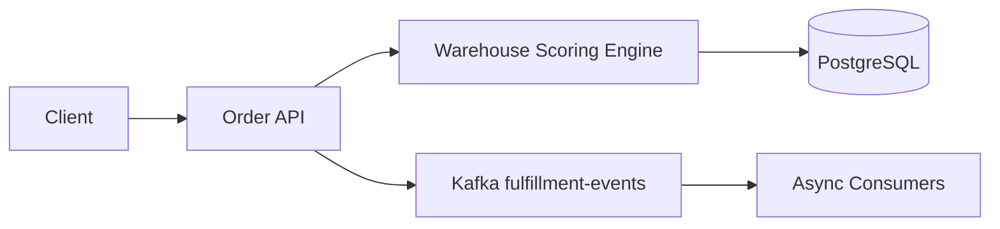

# FulfillX Architecture

## Allocation score
`score = 0.7 × geographic distance + 0.3 × warehouse utilization penalty`

The scoring function favors nearby warehouses while avoiding overloaded facilities.
